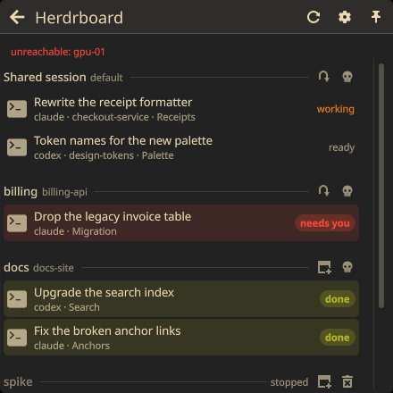
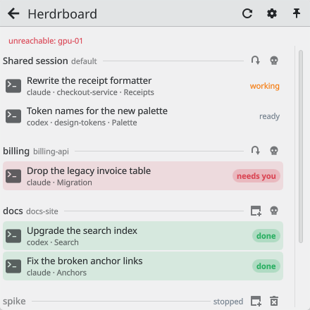
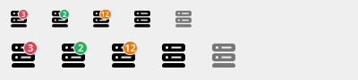
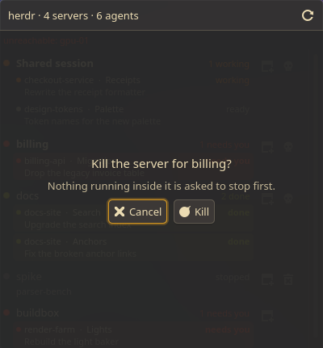

<div align="center">

# Herdboard

**[herdr](https://herdr.dev) in the KDE Plasma 6 system tray: every server and agent at a glance, one click to open or focus one.**

  

 

</div>

herdr runs one server per named session. They are easy to start and never stop
by themselves, because closing a window detaches rather than ends the session,
so they pile up unseen. Herdboard puts the count in the tray and the list one
click away.

## What it shows

The tray icon carries a small corner mark. It is **red with a number** when
agents are waiting on an answer (the number is how many), a **green dot** when
work finished while you were looking elsewhere, and an **amber dot** while
something is still running. When every agent is idle there is no mark. Server
and agent totals are in the tooltip.



Each session is a section: its name with a quiet hint (`default` for the
shared session, and the workspace when all its agents share one), then one row
per agent. A row leads with what the agent is doing (its terminal title); the
second line is its kind (claude, codex, ...) and where it sits. A stopped
session names the workspaces herdr saved for it. The open and kill buttons of
a session appear when you hover its header or reach it with the keyboard.

| state | colour | meaning |
|---|---|---|
| **needs you** | negative (red) | herdr recognised an approval or a question on screen |
| **done** | positive (green) | it finished work you have not seen yet |
| working | neutral (amber) | busy |
| ready | dim | idle, waiting for input |

State is said once, on the right: a pill for **needs you** and **done** (and
a light wash over the row), quiet text for working and ready. The pill of the
agent that started asking since the last refresh breathes. All colours come
from your colour scheme. With nothing to show, the popup says so in one
sentence with one action: *New Session*, *Try Again*, or *Get herdr*.

In the system tray the tray's own header carries the title and the refresh,
configure and pin buttons; Herdboard draws no second header there.

## What it does

- **Click a session** (or `O`) to open it. A session shows at most one window,
  because two windows on one session mirror each other, so this raises the
  window that already shows it (switching virtual desktop and un-minimising if
  needed) and only opens a new window when there is none, in your default
  terminal (System Settings → Default Applications → Terminal; Konsole when
  nothing is set).
- **Click an agent line** (or `Enter`) to land on that agent: its pane is
  focused inside the server first, then the window comes up. That also marks a
  finished agent as seen.
- **The skull** (or `K`) kills that server. It asks first, and the question
  opens on **Cancel**. It signals the process (TERM, then KILL a second later)
  rather than asking over herdr's socket, so a wedged server still goes.
- **The bin** (or `X`) deletes a stopped session for good. The shared
  `default` session is never deleted from here.
- `Up`/`Down` walk the agents, `R` refreshes, and so does a middle click on the
  tray icon.



The list refreshes every 3 seconds while the popup is open. Closed, it refreshes
every 5 seconds while the badge is showing something and every 20 seconds when
everything is idle. Every local herdr call has a 5 second timeout, and a server
whose snapshot cannot be read gets an error on its own row instead of zeroing
the others.

## How it finds windows

Plasma gives no shell access to the window list, so Herdboard asks
KWin: it loads a small KWin script over D-Bus
(`org.kde.KWin /Scripting loadScript`), runs it, and the script prints each
window's process id and window id (never titles) to KWin's log, which is read
back from the systemd journal by a tag unique to that call. The script is then
unloaded. Each herdr client process is walked up the process tree until a
window's process id turns up. Raising a window is the same trick with
`workspace.activeWindow = window`.

A round trip takes about 35 ms and leaves one line in the journal. It only
runs while the popup is open or when you open a session.

A terminal that puts every window in one process (kitty `--single-instance`,
Konsole's single-process mode) gives several windows the same process id. Those
windows are skipped rather than guessed at: the session is not shown bold and
opening it starts another window. Plain `kitty` and Konsole (which Herdboard
starts with `--separate`) are matched normally.

## Remote machines

Enabled machines from `herdr machine list` are part of the herd, read over
herdr's own `--machine` routing (herdr 0.9.1 or newer on both ends). Their
agents count toward the badge like local ones; a remote row carries the
machine's label, and a machine that cannot answer is named under the header.
Clicking opens `herdr --remote <target> --session <name>`. Killing and deleting
stay local: remote rows offer neither.

## Install

```bash
git clone https://github.com/fatihaydost/herdboard
cd herdboard
./install.sh --reload
```

`--reload` restarts plasmashell so a widget already in the tray picks up new
code (herdr servers are not affected). Herdboard appears in the system tray; if
it does not, right-click the tray arrow → *Configure System Tray…* →
*Entries* → *Herdboard* → *Always shown*.

Requirements: Plasma 6, `herdr` and `jq`. `qdbus6` and `journalctl` find the
window showing a session (without them every session looks windowless and a
click opens a new window), `ss` (iproute2) finds the process behind a session
for the skull, and windows open in your default terminal
(`TerminalApplication`/`TerminalService` in kdeglobals, then
`xdg-terminal-exec`, then `konsole`).

## Screenshots without your data

The data script has a demo mode, so a screenshot carries invented sessions:

```bash
package/contents/scripts/herdboard-sessions demo on
# ... take the screenshot ...
package/contents/scripts/herdboard-sessions demo off
```

Every action is a no-op while it is on.

## Development

```bash
node tests/logic.test.js                                  # pure helpers
bash tests/script.test.sh                                 # data script, stub herdr
/usr/lib/qt6/bin/qmllint -I /usr/lib/qt6/qml package/contents/ui/*.qml
package/contents/scripts/herdboard-sessions list | jq .   # the data the widget draws
./build.sh                                                # herdboard.plasmoid
```

## Remove

```bash
kpackagetool6 --type Plasma/Applet --remove io.github.fatihaydost.herdboard
rm -rf ~/.cache/herdboard   # only exists if demo mode was used
```

Your herdr sessions live in `~/.config/herdr/` and are untouched.

## License

MIT
